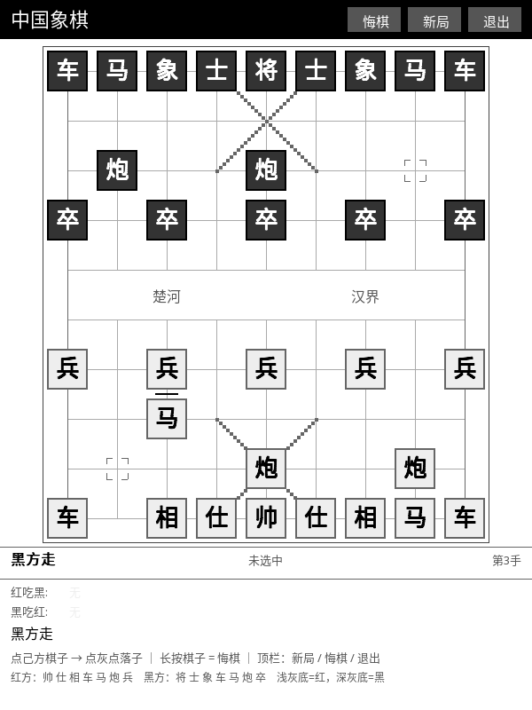
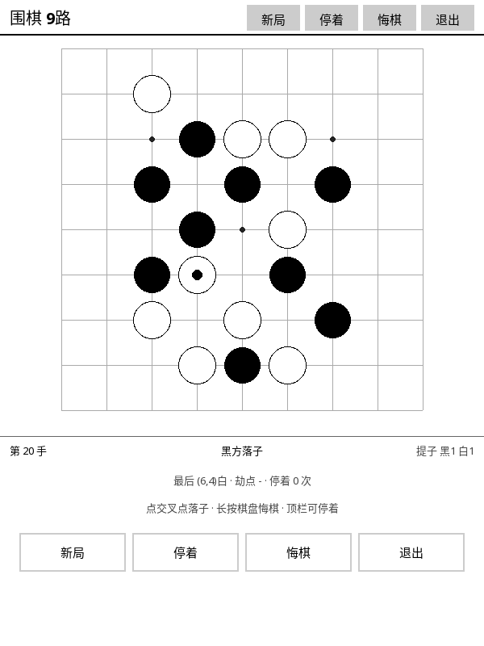
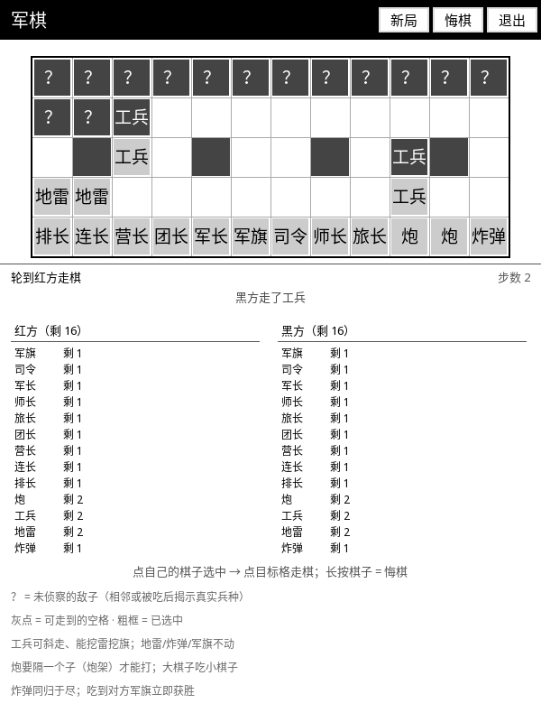
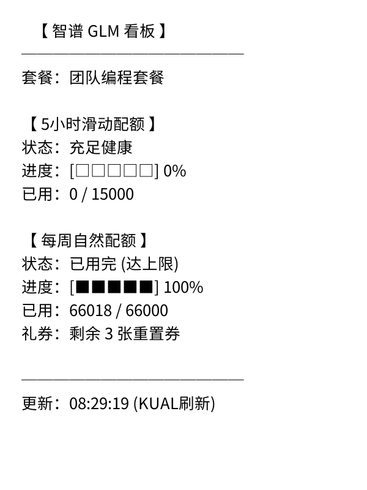
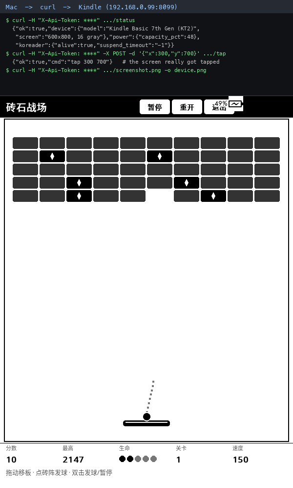

# Kindle KOReader 墨水屏应用合集 (kindle-koreader-app)

[](LICENSE)
[](https://koreader.rocks/)

专为 Amazon Kindle 墨水屏生态量身打造的应用合集。解决传统应用在电子墨水屏上
「刷新闪烁拖影」「触控按键过小不易按」「屏幕利用率低」等痛点。

---

## 📚 功能索引

| # | 功能 | 一句话 | 文档 | 截图 |
| :--- | :--- | :--- | :--- | :--- |
| 1 | 🎮 **方块战争** (Tetris) | 全屏大视野的俄罗斯方块，长按加速下滑 | [介绍](docs/features/tetris.md) |  |
| 2 | 🧱 **砖石战场** (Breakout) | 挡板跟手的打砖块，带落点预测与 17 种道具 | [介绍](docs/features/breakout.md) |  |
| 3 | 🔢 **数独** (Sudoku) | 唯一解保证的纸面数独，笔记/撤销/提示/存档 | [介绍](docs/features/sudoku.md) |  |
| 4 | ♟️ **国际象棋** (Chess) | 同机双人对弈的完整规则国际象棋 | [介绍](docs/features/chess.md) |  |
| 5 | 🐎 **中国象棋** (Xiangqi) | 汉字棋子，同机双人对弈 | [介绍](docs/features/xiangqi.md) |  |
| 6 | ⚫ **围棋** (Go) | 9 路棋盘，含提子/打劫/停着/算分 | [介绍](docs/features/go.md) |  |
| 7 | 🎖️ **军棋** (Junqi) | 16 v 16 陆战棋，带隐藏信息与兵种比较 | [介绍](docs/features/junqi.md) |  |
| 8 | 📊 **智谱 GLM 看板** (GLM Usage) | 在墨水屏上看 GLM 的额度消耗 | [介绍](docs/features/glm-usage.md) |  |
| 9 | 📡 **后台 HTTP 接口** (krapi) | 让 AI 通过 HTTP 直接操作这台设备 | [介绍](docs/features/kindle-api.md) |  |

> 每个功能的详细玩法、特点与截图，点「介绍」进对应文档。

---

## 🚀 安装部署

### 前置要求

- 已越狱的 Kindle 设备（Paperwhite 2/3/4、Voyage、Oasis、Basic 等）。
- 设备已安装 [KOReader](https://koreader.rocks/)。
- 想用 GLM 桌面看板的话，另需 [KUAL](https://www.mobileread.com/forums/showthread.php?t=203380)。

### 方式一：SSH / SCP（推荐）

Kindle 连上同一 Wi-Fi，开启 KOReader 内置 SSH（默认 `2222`，用户 `root`）：

```bash
git clone https://github.com/weibaohui/kindle-koreader-app.git
cd kindle-koreader-app

IP="192.168.0.99"          # 换成你设备的实际 IP
PORT="2222"

# 游戏插件
for g in tetris breakout sudoku chess xiangqi go junqi; do
  scp -P $PORT -r "plugins/$g.koplugin" root@$IP:/mnt/us/koreader/plugins/
done

# GLM 用量（KOReader 插件 + KUAL 扩展）
scp -P $PORT -r plugins/glmusage.koplugin root@$IP:/mnt/us/koreader/plugins/
scp -P $PORT -r extensions/glm_usage root@$IP:/mnt/us/extensions/
```

> 新增插件目录后需要**重启 KOReader** 才会被插件加载器扫到；
> 已有插件只改代码的话，覆盖文件后从菜单重新进入即可热重载。

### 方式二：USB 数据线

1. 用数据线把 Kindle 连到电脑，打开弹出的 Kindle 磁盘目录。
2. 把 `plugins/*.koplugin` 整个复制到 `koreader/plugins/`。
3. 把 `extensions/glm_usage` 复制到 `extensions/`。
4. 安全弹出磁盘，重启 KOReader。

---

## ⚙️ 配置

### 智谱 GLM API Key

在设备 `/mnt/us/extensions/glm_usage/` 下建配置文件：

```bash
ssh -p 2222 root@<Kindle_IP>
cd /mnt/us/extensions/glm_usage
cp glm_config.env.example glm_config.env
vi glm_config.env
```

```bash
API_KEY="your_api_key_id.your_api_key_secret"
ORG="可选组织ID"
```

改完在 KUAL 里打开「GLM 用量监控」即可。

---

## 🛠️ 配套工具

| 脚本 | 作用 |
| :--- | :--- |
| `tools/kindle_screenshot.sh` | 真机截图（下载完自动删设备端那张，零残留） |
| `tools/sim_*.lua` | 各游戏的无头逻辑测试台，不用上机就能跑 |
| `tools/check_games.sh` | 游戏插件合规体检（手势注册、墨水屏刷新规则、Lua 5.1 语法） |
| `tools/verify_sudoku_device.sh` | 数独真机交互验证（注入手势 + 逐帧截图） |
| `tools/cleanup_device.sh` | 设备现场清理（撤临时插件 + 装触控助手 + 测清理脚本） |
| `tools/krapi/sync_check.sh` | 检查仓库与 skill 两份 krapi 副本是否漂移 |
| `tools/krlauncher.koplugin` | 真机验证用的临时启动器（按命令直接打开某个游戏窗口） |
| `tools/measure_*.py` | 逐像素测量真机渲染（挡板跟手精度、底栏稳定性） |

后台 HTTP 接口（krapi）的**实现归属 skill `kindle-screen-automation`**
（该 skill 的 `scripts/krapi/`），仓库 `tools/krapi/` 是等价的镜像副本，
便于直接 clone 仓库部署；两份是否一致由 `tools/krapi/sync_check.sh` 把关。
接口说明见 [接口介绍](docs/features/kindle-api.md)。

---

## 📄 开源许可证

本项目基于 [MIT 许可证](LICENSE) 开源，欢迎提交 Issue 与 Pull Request 共同完善！
