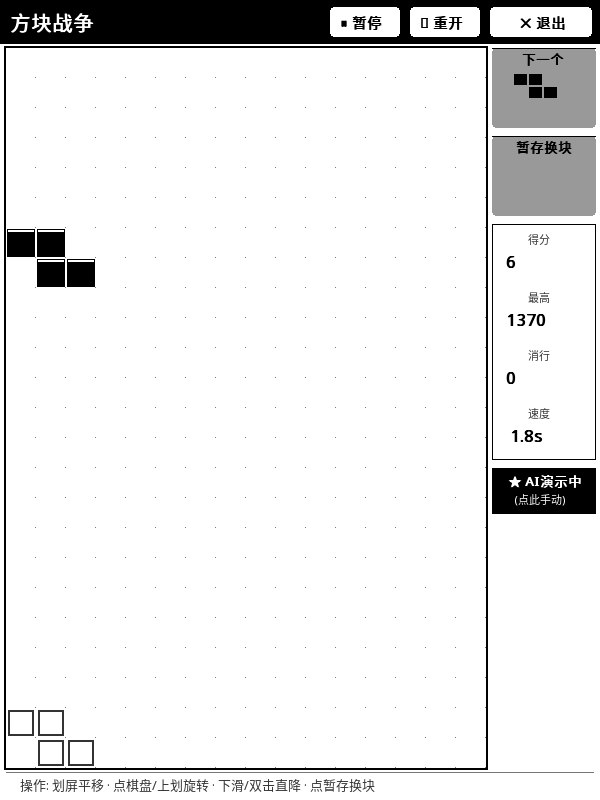
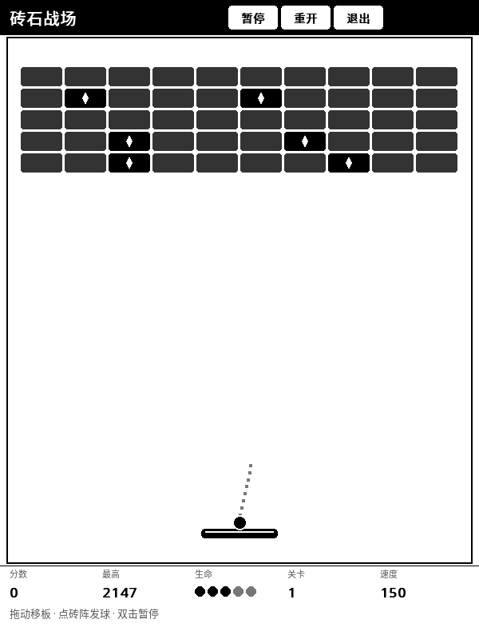
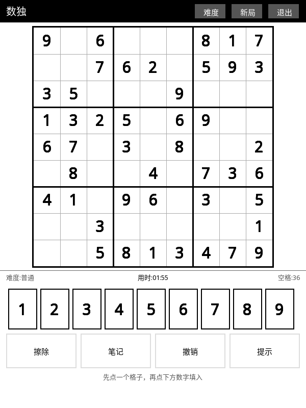

# Kindle KOReader 墨水屏精选应用与插件合集 (kindle-koreader-app)

[](LICENSE)
[](https://koreader.rocks/)

专为 Amazon Kindle 墨水屏生态量身打造的精选应用与扩展插件仓库。解决传统应用在电子墨水屏（E-ink）上“刷新闪烁拖影”、“触控按键过小不易按”、“屏幕利用率低”等痛点，提供极致舒适从容的墨水屏人机交互体验。

---

## 🌟 包含模块一览

### 1. 🎮 方块战争 (Tetris) - 墨水屏全屏大视野定制版
> 路径：[`plugins/tetris.koplugin/`](plugins/tetris.koplugin/)
> 设计文档：[`docs/TETRIS_ACCEL.md`](docs/TETRIS_ACCEL.md)（长按加速下滑的设计与真机验证）

专为 Kindle 600×800（及以上）电子纸深度重构的俄罗斯方块插件：
- **80% 极限游戏视野**：横向占据屏幕整整 80.0%（480px 宽度），告别传统小窗口。
- **1:1 绝对正方形网格（16列 × 24行）**：共 384 格大棋盘，方块外观小巧精致、比例严格对称，彻底消除拉伸变形。
- **纯手势盲操体验**：
  - **点棋盘任意处 / 上划**：顺时针旋转方块。
  - **左右划屏**：左右平移方块。
  - **下滑 / 屏幕双击**：直坠速降到底并锁定。
  - **轻触暂存框**：换块暂存（Hold）。
- **长按加速下滑（按住即砸）**：
  - **按住屏幕任意处**（右侧「暂存换块」面板除外），方块立刻进入加速下滑：下落间隔从 1.80 秒/格 缩短到 **0.10 秒/格**，真机实测 **9.45 格/秒**，约为常速的 **18 倍**；**抬手瞬间恢复常速**。
  - 加速中右侧速度卡显示黑底反白的**「加速中」**，玩家一眼就能确认自己正按着。
  - 加速期间只刷新方块所在的**列带**（约 120×60px）而不是全屏，把墨水屏的刷新预算省下来，才跑得出「按住就往下砸」的手感；真机实测**无残影拖尾**。
  - **长按右侧「暂存换块」面板仍然是换块**，不会被加速抢走 —— 长按手势按屏幕区域分流（棋盘区 / 右侧看板区加速，暂存面板换块）。
- **护眼恒定下落速度（杜绝拖影）**：
  - 默认采用从容护眼的 **1.80 秒 / 格** 恒定下落速度，绝不随关卡变快。方块下落速度严格适配墨水屏物理刷新速率，彻底消灭动画重影与残影异形。
  - 右侧看板内置**速度切换卡**，轻触即可在 `1.8s` / `2.4s` / `1.4s` / `1.0s` 之间随意切换。
- **AI 智能观战模式**：
  - 内置基于启发式评估函数的 AI 自动规划引擎，支持一键开启 AI 自主游玩与演示，随时轻触切换回手动接管。
- **消行计分与最高分持久化**：
  - 支持单行、双行、三行与 Tetris 四行复合消除奖励，记录并自动保存历史最高分至存储。



---

### 2. 🧱 砖石战场 (Breakout) - 墨水屏打砖块
> 路径：[`plugins/breakout.koplugin/`](plugins/breakout.koplugin/)
> 设计方案：[`docs/BREAKOUT_PLAN.md`](docs/BREAKOUT_PLAN.md)

专为 600×800 墨水屏重做的打砖块（Breakout）KOReader 插件。与《方块战争》同构，菜单一键启动：
- **格点步进物理（杜绝穿模）**：连续角度 + 100ms 固定 tick + ≤5px 子步，撞墙/撞挡板/撞砖沿最小穿透轴反射，手感真实且不漏判。
- **击球点决定出射角（品类灵魂）**：击中挡板的位置决定出射方向与旋转量（最大 1.0 rad），强制保留 ≥12% 横向分量，避免死锁于垂直轨道。
- **落点静态预测标记**：飞行中用十字标记预测球落点 —— 用静态标记替代连续轨迹动画，既规避墨水屏残影，又把纯反应游戏升级为**可瞄准游戏**。
- **球带白色描边**：纯黑球在纯黑/深灰砖上会糊掉，先画一圈白环再画黑球 —— 白底上完全隐形，任何深色砖上都能把球"抠"出来。
- **五类砖块（不依赖颜色）**：普通砖（**深灰底**）/ 多血砖（纯黑 + 白 pip 编码血量）/ 精英砖（双 pip）/ 钢砖（浅灰底 + 菱形点阵，不可破）/ 道具砖（纯黑 + 白色菱形）。**四档灰度分层**：普通砖数量最多、最不值得瞄，让它退到深灰"背景层"，值得打的砖（多血 / 道具）自动跳出来；血量仍由白 pip 精确表达，不引入第二套灰阶语义。
- **关卡递进**：4 个手工关卡（经典 → 强化砖 → 钢砖墙 → 金字塔），第 5 关起程序化生成，难度持续攀升。
- **连击倍率**：同一球在两次触板之间连续击砖，每次 +0.1 倍率，上限 **2.0×**；过关额外奖励 `200 × 关卡 + 100 × 剩余生命`。
- **🔷 掉落道具系统（7 种）**：击碎**道具砖**（纯黑 + 白色菱形 pip，**手工关卡每关 6 块、程序化关卡 6→10 块随关卡递增**）掉落徽章，徽章慢速直落（100px/s），用挡板接取：
  | 道具 | 效果 | 时长 | 好坏 |
  |---|---|---|---|
  | 加长 | 挡板 96 → 132px | 12s | 增益 |
  | 多球 | 1 球分裂为 3 球（上限 4 球） | 即时 | 增益 |
  | 减速 | 球速 ×0.7 | 12s | 增益 |
  | 加命 | 生命 +1（上限 5） | 即时 | 增益 |
  | 吸盘 | 球粘在挡板上，轻触释放 | 10s | 增益 |
  | 变短 | 挡板 96 → 64px | 10s | 减益 |
  | 加速 | 球速 ×1.35 | 8s | 减益 |
  - 图标全部是**纯几何剪影**（横杠 / 三点 / 钟面 / 十字 / U 碗 / 双箭头），**纯黑底 = 增益、浅灰底 = 减益**，玩家一眼分好坏。
  - 道具**落点用空心方框**标记（球的落点用十字 + 黑心），形状区分不混淆；底栏效果条实时显示生效道具与剩余秒数。
  - **只有全部球都掉出底线才扣命** —— 多球不让慢节奏玩家频繁丢命。
- **分区刷新 + 残影预算**：**只有真的动了才刷新**——静止时一个像素都不推，脏区用完即清（不会随球路过的范围越滚越大）；碎砖当场精确擦那一格，砖阵区维护刷新降到 6s 一次且只在游戏中做；仅在关卡切换时才做全屏黑闪 —— 全局黑闪次数 = 关卡数，把残影预算牢牢锁死。脏区分**多个独立桶**（运动区 / 底栏各格 / 浮层 / 砖阵区）分别推送，底栏**按格刷新**（分数变只刷分数那一格约 108×20，不再整条 580×92 闪白），相邻格留 4px 间隙防止被 KOReader 合并。
- **静止画面绝不闪烁**：真机连拍 10 帧**逐像素完全一致**（修复前 10 帧里有 2 帧糊掉半屏、底栏整条空白）。
- **最高分持久化**：自动保存至 `DataStorage:getSettingsDir()/breakout_hiscore.txt`。
- **触控盲操**：拖动 = 跟手移动挡板（锚点 + 相对位移，绝不跳位，实测像素级准确）/ 点砖阵 = 发球 / 点底部 = 挡板绝对跳转 / 双击 = 暂停 / 顶栏三按钮（暂停·重开·退出，已避开系统状态栏遮挡区）。



---

### 3. 🔢 数独 (Sudoku) - 墨水屏纸面游戏
> 路径：[`plugins/sudoku.koplugin/`](plugins/sudoku.koplugin/)
> 设计文档：[`docs/SUDOKU.md`](docs/SUDOKU.md)（出题算法、形状化视觉、真机验证）

专为 600×800 墨水屏重做的数独 KOReader 插件。**墨水屏上最省刷新预算的一类游戏**——它本来就是纸面游戏，静止时一个像素都不刷：
- **两阶段出题，保证唯一解**：先随机挖空到目标难度，再**逆序恢复**直到全局唯一解（MRV 回溯 + 解数上限 2 的提前剪枝）。困难局实测 **0.013 秒/局**，点「新局」零等待。
- **三档难度**：简单 / 普通 / 困难（给定数 42 / 32 / 25，实盘格数按唯一解约束浮动）。
- **形状化视觉，不依赖颜色**（16 级灰度 + 无前光下颜色语义全部失效）：
  - 题目给定 = 纯黑粗体；**玩家填入 = 纯黑 + 数字下方一条短横线**（一眼分清哪些是自己填的）。
  - **冲突用删除线**横穿数字，而不是红字。
  - **笔记得号** = 3×3 小号浅灰字，退到背景层不抢视线。
  - 选中格 = 内嵌 3px 粗框，**不做整行整列反白**。
- **数字键盘自动灰掉"本行/列/宫已用"的数字** —— 等价于"哪些数字还能填"，但只刷 9 个小按钮，比反白整行整列省一个数量级的刷新预算。
- **完整交互**：点格选中 → 点数字填入（再点同数字 = 擦除）/ **长按格子清空** / 笔记模式（候选数增删）/ 撤销 / 提示（自动填一格并计数）。
- **进度持久化**：断电、退出插件都不丢局，重开自动续上；完成局自动记录**各难度最佳用时**。
- **刷新策略**：只有真的变了才刷 —— 选格只刷那一格 + 键盘，计时器每秒只刷状态条的时间格。



---

### 4. 📊 智谱 GLM 大模型额度看板 (GLM Usage)
> 包含两套运行模式：
> - KOReader 工具插件：[`plugins/glmusage.koplugin/`](plugins/glmusage.koplugin/)
> - KUAL 原生扩展：[`extensions/glm_usage/`](extensions/glm_usage/)

随时随地在 Kindle 上便捷掌握智谱 AI（GLM）API 用量消耗：
- **HS256 签名动态认证**：无需外部中转服务，Kindle 本地利用 `openssl` 或 Python 动态生成 JWT 鉴权凭据直接与智谱开放平台通信。
- **多维度配额全景监控**：
  - **5 小时滑动窗口**：当前用量比例、剩余 Token / 额度、下次重置时间。
  - **每周自然周期配额**：本周累计消耗、剩余额度、配额重置倒计时。
  - **重置券状态**：实时统计可用团队重置券剩余张数。
- **双运行形态**：
  - **KOReader 内部运行**：通过顶部工具栏“智谱 GLM 用量查询”一键弹出文字看板查看。
  - **KUAL 原生桌面运行**：基于 `fbink` 硬件加速直接刷新到墨水屏全屏，呈现精美的字符进度条卡片看板。

```text
   【 智谱 GLM 看板 】
──────────────
套餐：团队编程套餐

【 5小时滑动配额 】
状态：充足健康
进度：[□□□□□] 0%
已用：0 / 15000

【 每周自然配额 】
状态：已用完 (达上限)
进度：[■■■■■] 100%
已用：66018 / 66000
礼券：剩余 3 张重置券

──────────────
更新：14:15 (已刷新)
```

---

## 📂 项目目录结构

```text
kindle-koreader-app/
├── LICENSE                    # MIT 开源协议
├── README.md                  # 详细使用与说明文档
├── docs/
│   ├── BREAKOUT_PLAN.md        # 打砖块游戏设计方案（调研 + 设计 + 实施路线）
│   ├── TETRIS_ACCEL.md         # 方块战争「长按加速下滑」设计与真机验证（含两个 KOReader 引擎级坑的复盘）
│   ├── SUDOKU.md               # 数独设计方案（出题算法 / 形状化视觉 / 真机验证 / 触控注入坑）
│   └── screenshots/           # 实机运行效果截图
├── plugins/
│   ├── tetris.koplugin/       # 俄罗斯方块 KOReader 插件
│   │   ├── _meta.lua          # 插件元信息
│   │   ├── main.lua           # 菜单入口注册
│   │   └── tetrisdialog.lua   # 游戏主逻辑、UI 渲染与手势引擎
│   ├── breakout.koplugin/     # 打砖块 KOReader 插件
│   │   ├── _meta.lua          # 插件元信息
│   │   ├── main.lua           # 菜单入口注册
│   │   └── breakoutdialog.lua # 物理引擎、触控手势、分区刷新与关卡系统
│   ├── sudoku.koplugin/       # 数独 KOReader 插件
│   │   ├── _meta.lua          # 插件元信息
│   │   ├── main.lua           # 菜单入口注册
│   │   └── sudokudialog.lua   # 出题求解器、棋盘渲染、触控交互、分区刷新与存档
│   └── glmusage.koplugin/     # GLM 用量 KOReader 插件
│       ├── _meta.lua          # 插件元信息
│       └── main.lua           # 菜单与展示浮层
└── extensions/
    └── glm_usage/             # GLM 用量 KUAL 扩展
        ├── menu.json          # KUAL 扩展配置
        ├── glm_config.env.example # API 密钥配置模板
        └── bin/
            ├── query.sh       # 联网请求与 JWT 签名生成核心脚本
            ├── format_dashboard.lua # 看板数据格式化与进度条计算
            ├── glm_query.py   # Python 版完整查询引擎
            ├── run.sh         # KUAL 启动入口
            └── config_key.sh  # 屏幕提示引导脚本
├── tools/
│   ├── kindle_screenshot.sh   # 零残留真机截图脚本
│   ├── kindle_tap.sh          # 设备端触控点击注入（⚠️ zforce2 机型无效，见下方说明）
│   ├── touch_drag.lua         # 设备端触控拖拽注入
│   ├── touch_hold.lua         # 设备端触控长按注入
│   ├── touch_doubleclick.lua  # 设备端触控双击注入
│   ├── breakout_autoplay.py   # 打砖块自动接球回归脚本
│   ├── breakout_powerup_probe.py # 打砖块掉落道具链路自动探测（道具砖→掉落→接取→生效）
│   ├── brick_palette_preview.py  # 砖块灰阶配色候选本地预览（不用上机就能比对方案）
│   ├── count_power_bricks.py   # 逐砖清点真机截图里的道具砖/血量砖/钢砖数量与坐标
│   ├── sim_headless.lua        # 打砖块无头逻辑测试台（mock 掉 KOReader 依赖，70 项断言）
│   ├── sim_sudoku.lua          # 数独无头逻辑测试台（28 项断言：唯一解/交互/脏区/存档）
│   ├── verify_sudoku_device.sh # 数独真机交互验证（注入手势 + 逐帧截图）
│   ├── cleanup_device.sh       # 设备现场清理（撤临时插件 + 装触控助手 + 测清理脚本）
│   ├── measure_paddle.py      # 逐像素测量真机挡板位置（验证跟手精度）
│   ├── measure_botbar.py      # 底栏稳定性连拍测量（逐像素比对，验证"静止不闪"）
│   └── deploy_breakout.sh     # 一键部署打砖块插件到真机
```

> ⚠️ **触控注入说明**：`tools/kindle_tap.sh` 等脚本走的是"往 `/dev/input/event1` 写 `input_event`"这条路。
> 在 **KT2（zforce2 触摸驱动）** 上这条路的 `write()` 虽然返回成功，但**事件进不了输入子系统**，
> 真机上点不动 —— 别把它当成"插件不响应点击"的证据。
> 可行的替代方案（走 KOReader 自己的 `Input:handleTouchEv` → `GestureDetector` → `UIManager:sendEvent`）
> 见 skill `kindle-screen-automation` 的 `scripts/kr_tap_helper.koplugin` 与 `scripts/tap.sh`。

---

## 🚀 安装部署指南

### 前置要求
- 已越狱的 Kindle 设备（如 Paperwhite 2/3/4、Voyage、Oasis、Basic 等）。
- 设备已安装 [KOReader](https://koreader.rocks/)。
- 若需使用桌面看板，建议已安装 [KUAL](https://www.mobileread.com/forums/showthread.php?t=203380)。

---

### 方法一：通过 SSH / SCP 快速安装（推荐）

将 Kindle 连接至同一 Wi-Fi，开启 KOReader 内置的 SSH 服务器（默认端口 `2222`，用户 `root`）：

```bash
# 克隆本仓库
git clone https://github.com/weibaohui/kindle-koreader-app.git
cd kindle-koreader-app

# 替换为你的 Kindle 实际 IP
KINDLE_IP="192.168.0.99"
KINDLE_PORT="2222"

# 1. 安装俄罗斯方块插件
scp -P $KINDLE_PORT -r plugins/tetris.koplugin root@$KINDLE_IP:/mnt/us/koreader/plugins/

# 2. 安装打砖块插件
scp -P $KINDLE_PORT -r plugins/breakout.koplugin root@$KINDLE_IP:/mnt/us/koreader/plugins/

# 3. 安装数独插件
scp -P $KINDLE_PORT -r plugins/sudoku.koplugin root@$KINDLE_IP:/mnt/us/koreader/plugins/

# 4. 安装 GLM 用量 KOReader 插件
scp -P $KINDLE_PORT -r plugins/glmusage.koplugin root@$KINDLE_IP:/mnt/us/koreader/plugins/

# 5. 安装 GLM 用量 KUAL 扩展
scp -P $KINDLE_PORT -r extensions/glm_usage root@$KINDLE_IP:/mnt/us/extensions/
```

> 新增插件目录后需要**重启 KOReader**才会被插件加载器扫到；
> 已有插件的代码改动只需覆盖文件，再从菜单重新进入即可热重载。

---

### 方法二：通过 USB 数据线安装

1. 用数据线将 Kindle 连接到电脑，打开弹出的 Kindle 磁盘目录。
2. 复制 `plugins/tetris.koplugin` 到 `koreader/plugins/` 目录。
3. 复制 `plugins/breakout.koplugin` 到 `koreader/plugins/` 目录。
4. 复制 `plugins/sudoku.koplugin` 到 `koreader/plugins/` 目录。
5. 复制 `plugins/glmusage.koplugin` 到 `koreader/plugins/` 目录。
6. 复制 `extensions/glm_usage` 到 `extensions/` 目录。
7. 安全弹出磁盘。

---

## ⚙️ 配置指南

### 配置智谱 GLM API Key

在 Kindle 设备上的 `/mnt/us/extensions/glm_usage/` 目录下创建配置文件：

#### 方式 A：通过 `glm_config.env` 文件配置（推荐）
复制模板文件并填入 API Key：
```bash
ssh -p 2222 root@<Kindle_IP>
cd /mnt/us/extensions/glm_usage
cp glm_config.env.example glm_config.env
vi glm_config.env
```
填入您的配置：
```bash
API_KEY="your_api_key_id.your_api_key_secret"
ORG="可选组织ID"
PROJ="可选项目ID"
```

#### 方式 B：直接写入 `api_key.txt` 单行文件
```bash
ssh -p 2222 root@<Kindle_IP> 'echo "your_api_key_here" > /mnt/us/extensions/glm_usage/api_key.txt'
```

---

## 🎮 使用与操作

### 俄罗斯方块
1. 打开 KOReader，点击顶部工具栏中的 **工具 (扳手与螺丝刀图标)**。
2. 点击 **“方块战争 (俄罗斯方块)”** 即可启动。
3. **操作要领**：
   - 绝大多数操作可通过划屏与轻触盲操完成。
   - 双击屏幕任意处可立即让方块下落到底。
   - 轻触棋盘任意空白处即可使方块顺时针旋转。
   - 右侧“速度”卡片可随时轻触微调下落节奏。
   - **按住屏幕不放**方块即进入加速下滑（速度卡显示「加速中」），**松手**立刻恢复常速；长按右侧“暂存换块”面板则依然是换块。

### 打砖块（砖石战场）
1. 打开 KOReader，点击顶部工具栏中的 **工具 (扳手与螺丝刀图标)**。
2. 点击 **“砖石战场 (打砖块)”** 即可启动。
3. **操作要领**：
   - **拖动屏幕**移动挡板（跟手，不会跳位）；也可**轻触底部区域**让挡板直接跳到该位置。
   - **轻触砖阵区域**发球；发球前会显示一条短瞄准射线，飞出后会显示**落点十字预测**。
   - **双击屏幕**暂停 / 继续（游戏内已关闭 KOReader 原生 double_tap，双击由插件自行判定，60–380ms 窗口）。
   - 顶栏三按钮：**暂停 / 重开 / 退出**。
4. **道具玩法**：
   - 砖阵里带**白色菱形 pip** 的黑砖是**道具砖**，击碎后会掉出徽章，徽章竖直慢速下落，**用挡板接住**。手工关卡每关 **6 块**、程序化关卡 **6→10 块**（越往后越多），掉得很勤快。
   - 挡板下方会出现**空心方框**标记道具的落点（十字标记是球的落点），提前把挡板挪过去即可接住。
   - **黑底徽章 = 增益**（加长 / 多球 / 减速 / 加命 / 吸盘），**浅灰底徽章 = 减益**（变短 / 加速）。
   - 底栏效果条会显示当前生效的道具图标与**剩余秒数**；吸盘生效时球会粘在挡板上，**轻触屏幕任意处**释放。

### 数独
1. 打开 KOReader，点击顶部工具栏中的 **工具 (扳手与螺丝刀图标)**。
2. 点击 **“数独 (Sudoku)”** 即可启动。
3. **操作要领**：
   - **点一个空格**选中它（格内出现粗框），再**点下方数字**填入；再点同一个数字 = 擦掉。
   - **长按格子**直接清空该格。
   - **笔记**按钮切到候选模式，此时点数字是"加/取消候选数"（小号浅灰字）。
   - **撤销**回退上一步（填数 / 擦除 / 笔记都算）。
   - **提示**自动填一个正确的数进空格，提示次数会显示在底部提示行。
   - 数字键盘会把**本行/列/宫已经用过**的数字变灰 —— 灰的就是这一格不能填的。
   - 顶栏三按钮：**难度 / 新局 / 退出**；退出后进度自动存盘，下次进来接着玩。

### 一键部署打砖块插件

```bash
./tools/deploy_breakout.sh 192.168.0.99
```

脚本会自动完成：探活 → 清理设备端临时文件 → 上传插件（**软部署，无需重启 KOReader**）→ 打开游戏并截图。
配合 `tools/measure_paddle.py` 可逐像素校验挡板跟手精度。

### GLM 额度用量看板
- **KOReader 内部**：顶部工具栏 -> 更多工具 -> **智谱 GLM 用量查询**。
- **KUAL 菜单**：打开 KUAL 书本 -> 点击 **GLM 用量监控** -> **刷新并查看 GLM 用量**。

---

## 📄 开源许可证

本项目基于 [MIT 许可证](LICENSE) 开源，欢迎提交 Issue 与 Pull Request 共同完善！
