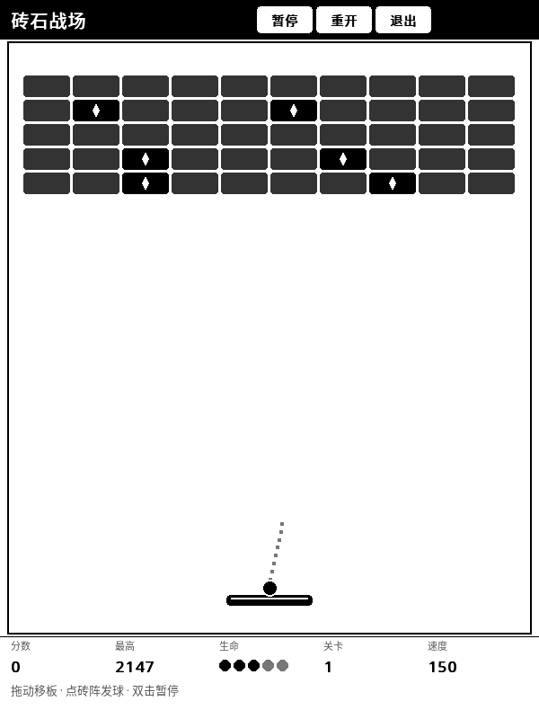
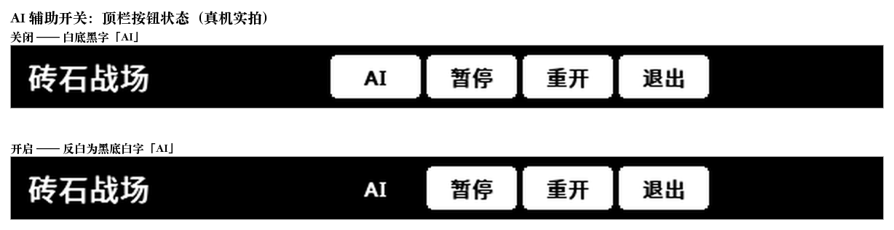
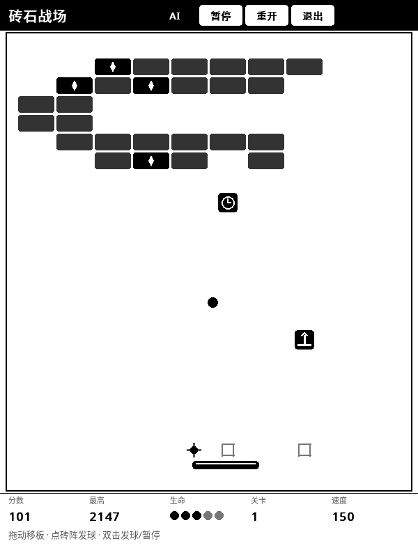
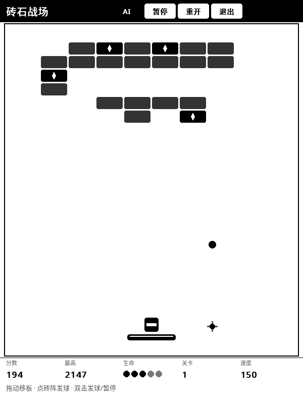
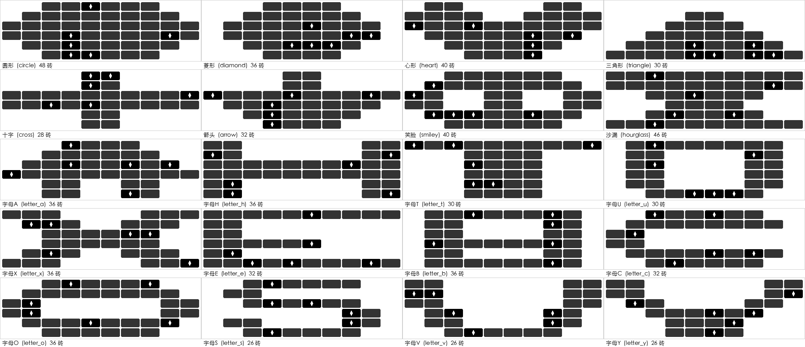
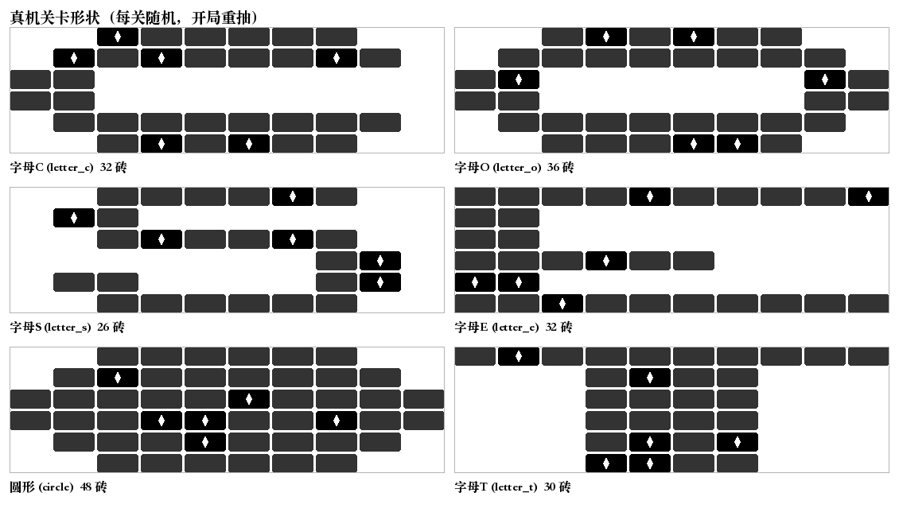
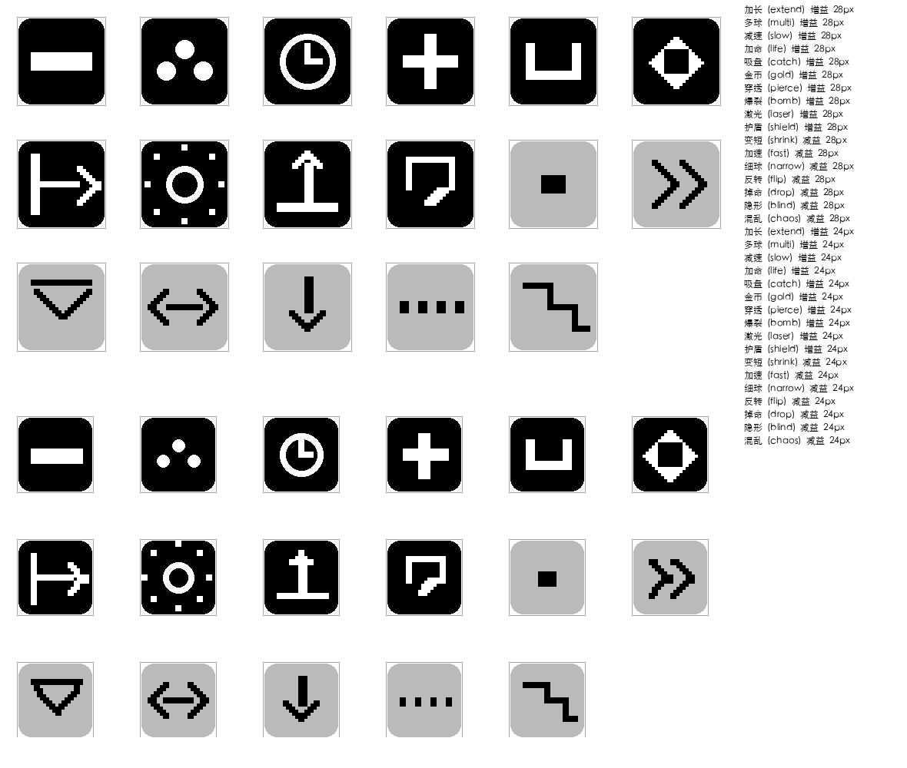
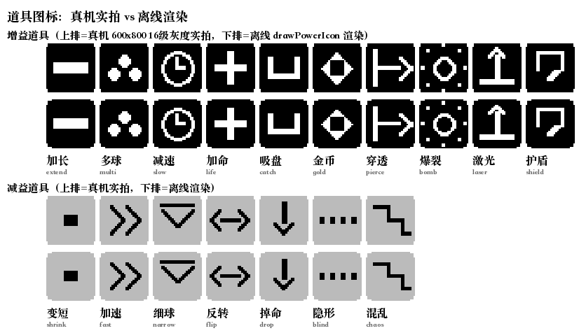
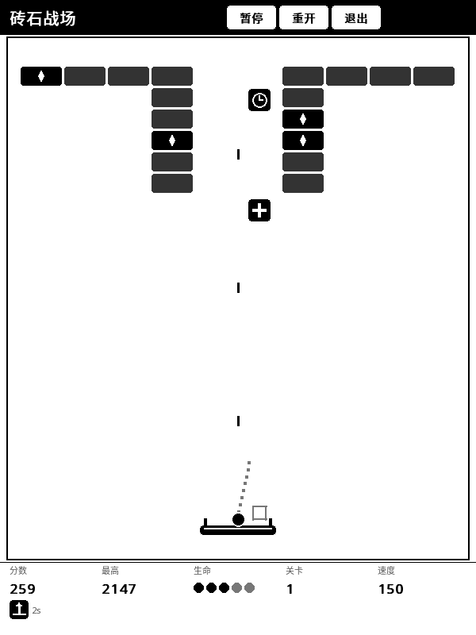

# 🧱 砖石战场 (Breakout)

墨水屏打砖块——挡板跟手不跳位，弹道有落点预测，还能一边打一边捡道具。

## 这是什么

打砖块，但按墨水屏的脾气重做了三件事：**跟手的挡板**、**可读的弹道**、**能捡的道具**，
外加每关换一个**随机形状**的砖阵。

## 怎么玩

1. 打开 KOReader → 顶部工具栏 **工具** → **砖石战场 (打砖块)**。
2. **拖动屏幕**移动挡板（跟手，不会跳位）；也可**轻触底部区域**让挡板直接跳到该位置。
3. **轻触砖阵区域**发球；发球前会显示一条短瞄准射线，飞出后显示**落点十字预测**。
4. **双击屏幕**暂停 / 继续。
5. **双击屏幕也能直接发球**：球停在挡板上还没出发时，双击任意位置即可发射弹珠，
   不用非得瞄准砖阵下方那块区域。
6. 顶栏四按钮：**AI / 暂停 / 重开 / 退出**。

## AI 辅助

顶栏最左边有个 **AI** 开关，点一下挡板就会**自己跟住球**——
它盯的是球的预测落点，而不是球的当前位置，所以球还在半空飞的时候，
挡板已经挪到它即将落下的位置等着了。

开启后按钮**反白成黑底白字**，一眼能看出当前是开着的。

几点说明：

- **它只管"接"，不管"开"**：发球还是你自己点一下，AI 不替你发。
- **玩家永远优先**：你一拖动挡板，AI 立刻让位；停手约 1 秒后它再接回来。
  所以可以随时自己接管，不会跟 AI 抢挡板。
- **它比人稳**：真机上实测，AI 开着连打 3000 帧（5 分钟）**零漏球**；
  同样的时间人类玩家早就漏掉好几颗了。
- 适合两种用法：想轻松通关时开着，想练手感时关掉。

### 顺手接道具

球不急的时候，AI 还会**顺手把正在下落的道具接住**。

图里球正落向右边（落点十字在 420），道具却落在左边 300——
AI 选择先去接道具，接完再赶回球的位置。

它按三档来挑：

- **白捡**：球的落点本来就能覆盖这个道具，挡板一点都不用挪，顺手就接住。
- **顺路**：道具和球差不多同时落地，挡板停在两者的交集中心，一次接住两个。
- **绕路**：道具先落地，挡板先挪过去接住，再赶回球的落点。

两条底线：

- **球永远优先**：时间来不及它就放弃道具，回去接球。
- **减益不碰**：变短 / 加速 / 细球 / 反转 / 隐形 / 混乱 / 掉命 这些减益道具，
  AI 不会专门绕路去接——尤其"掉命"是直接扣一条命的。

真机上实测：AI 绕路接道具时，**球和道具两个都接住了**，一条命没掉。
同一批对局里开关对比，AI 开着接到的道具比关着多四成以上。

> 顺带一提：AI 之所以能接得这么准，是因为它用的「落点预测」曾经被修好过——
> 原来那个预测把像素当成了时间步长，球一步就飞越全场，
> 结果屏幕上的落点十字标记几乎一直停在场地边上。这个 bug 一并修掉了。

## 砖阵形状

砖阵不再是固定的好几排长方形，而是**每一关随机抽一个形状**铺出来——
每次开局、每一关都换花样，相邻两关保证不重样。
过关浮层会提前告诉你下一关是什么形状。

| 类别 | 形状 |
| :--- | :--- |
| 剪影 | 圆形 · 菱形 · 心形 · 三角形 · 十字 · 箭头 · 笑脸 · 沙漏 |
| 字母 | A · B · C · E · H · O · S · T · U · V · X · Y |

形状是按 **10 列 × 6 行**的掩码定义的，砖还是普通砖，
只是"哪些格子空着"不同 —— 所以每一关的砖数会跟着形状在 **26~48** 块之间浮动，
有的关卡两下就清完，有的得磨一会儿。

真机实拍（同一台设备上连着重开抽到的 6 个不同形状）：

深色是普通砖，**带白色菱形 pip 的黑砖是道具砖**。

## 道具玩法

打碎**白色菱形 pip 的黑砖**会掉出徽章。徽章分两种底色，一眼可分好坏：
**黑底是增益，浅灰底是减益**。徽章落地的横坐标会提前用空心方框标出来，
掉得很慢（实测约 50 px/s），留出跑过去接的时间。

### 全部 17 种道具图标

上排是 28px 的掉落徽章尺寸，下排是 24px 的底栏效果条尺寸——
两种尺寸下剪影都能分清。

真机上这 17 个徽章逐个实拍过，和离线渲染**完全一致**（上排真机、下排离线）：

### 增益（10 种，黑底）

| 道具 | 效果 | 持续 |
| :--- | :--- | :--- |
| 加长 | 挡板变宽（96 → 132 px） | 12 秒 |
| 多球 | 一颗球裂成三颗（最多 4 颗） | 即时 |
| 减速 | 球速降到 70% | 12 秒 |
| 加命 | 生命 +1（上限 5 条） | 即时 |
| 吸盘 | 球粘在挡板上，轻触屏幕释放 | 10 秒 |
| 金币 | 分数 +1000 | 即时 |
| 穿透 | 球直接穿过砖块不反弹（砖照常掉血），球心会亮一个白点 | 8 秒 |
| 爆裂 | 撞到砖时把周围一圈的砖一起炸掉 | 8 秒 |
| 激光 | 挡板两侧装炮管，自动往上打子弹清砖 | 8 秒 |
| 护盾 | 挡板上方浮一层护壁，接住一颗球后消失 | 20 秒 / 一颗 |

### 减益（7 种，浅灰底）

| 道具 | 效果 | 持续 |
| :--- | :--- | :--- |
| 变短 | 挡板变窄（96 → 64 px） | 10 秒 |
| 加速 | 球速升到 135% | 8 秒 |
| 细球 | 球变小（半径 7 → 4 px），能钻进更窄的缝隙 | 12 秒 |
| 反转 | 左右输入被镜像：往右拖挡板往左走 | 8 秒 |
| 掉命 | 直接扣掉一条命（不打断当前球局） | 即时 |
| 隐形 | 挡板实体消失，只剩一圈浅灰虚线框 | 6 秒 |
| 混乱 | 每次触板的出射角随机抖动 | 10 秒 |

**吸盘**生效时球会粘在挡板上，**轻触屏幕任意处**释放。

每关 **6 块**道具砖起步，关卡越高越多，**10 块**封顶 —— 越往后掉得越勤快。
掉落大约三分之二出增益、三分之一出减益——徽章配色本身就是提示。

底栏效果条最多同时显示 **6 个**生效道具和各自的剩余秒数，
刚接住道具时还会在末尾补一条提示行。

道具从砖阵掉下来、被挡板接住、然后生效，是一条完整的链路（真机实拍）：

挡板两侧的炮管、往上飞的子弹、底栏倒计时，都是**激光**生效后的样子。

## 特点

- **分区刷新**：球、砖阵、挡板、底栏各刷各的，一帧只动该动的那几块。
- **静止不闪**：真机上连拍两帧逐像素比对，静止时 **0 / 480000 个像素**发生变化，
  插件的脏区桶也是空的 —— 一个像素都不刷。
- **效果条不刷屏**：同屏 6 个道具同时倒计时，也只每秒刷一次整条效果条。
- **手感按真机调**：挡板位置逐像素测量校验过跟手精度。
- **形状真机可辨**：20 种形状在真机 16 级灰度下逐个验过，剪影不会被灰阶吃掉。
- **AI 接得住**：AI 辅助连打 3000 帧零漏球，对照组（关掉 AI）挡板 5 秒纹丝不动。
- **AI 顺手接道具**：球不急时绕路把下落的增益道具也收了（+43%），减益不碰，命一条没掉。

## 相关文档

深度设计（内部文档）：[`docs/design/BREAKOUT_PLAN.md`](../design/BREAKOUT_PLAN.md)
