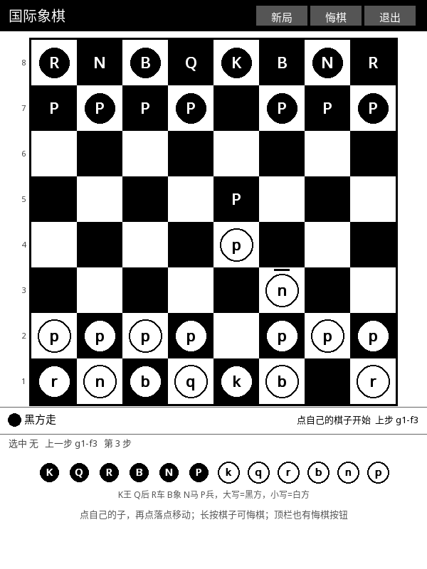

# ♟️ 国际象棋 (Chess)

完整规则的同机双人对弈国际象棋。墨水屏上不靠颜色认子——**大写是黑、小写是白**，深底浅底再叠一层形状编码。

## 这是什么

一台 Kindle 上能正经下完的国际象棋：走法合法性、易位、吃过路兵、升变、将死和棋，一个不缺。
两个人面对面用同一台设备轮流落子，不需要联网、不需要 AI。

## 怎么玩

1. 打开 KOReader → 顶部工具栏 **工具** → **国际象棋 (Chess)**。
2. **点自己的棋子**选中（外圈出现粗黑框），再**点目标格**落子。
3. 再点同一个棋子 = 取消选中；**长按棋子 = 悔棋**。
4. 顶栏三按钮：**新局 / 悔棋 / 退出**。
5. 状态条一直显示：轮到谁走、当前选中哪格、上一步走了什么、被将军时给出提示。
6. 退出后局面自动存盘，下次进来接着下。

## 棋子怎么认

| | 黑方 | 白方 |
| :--- | :--- | :--- |
| 字母 | `K Q R B N P` | `k q r b n p` |
| 底色 | 深底 + 白字 | 浅底 + 黑字 |

故意**不用 Unicode 棋类符号**（♞♝♛…），因为设备字体不一定带这些字形，会渲染成豆腐块。
字母是拉丁字母，任何字体都有。

## 支持的规则

| 规则 | 说明 |
| :--- | :--- |
| 基本走法 | 车走直线不穿子、马走日（**国际规则：可跳子**）、象走田不塞眼、兵直走一格 |
| 兵 | 初始可走两格、斜吃、不能后退、不能吃己方 |
| 易位 | 双方各一次，条件全查（王/车原位、空格、途中不受攻击、不在将军中） |
| 吃过路兵 | 兵两格推进后的下一手可以吃掉它 |
| 升变 | 兵走到底线自动升变为后 |
| 合法性 | 王不能走进被攻击的格子，也不能自己送将 |
| 胜负 | 将死判负、逼和与三次重复判和 |
| 吃王 | 不生成"吃王"走法，靠将军 + 将死来判胜负 |

> 马**不蹩马腿**——那是中国象棋的规则。国际棋谱里 `Nf3` 是合法的开局手，
> 照抄蹩马腿会让整局作废。代码里留了 `Engine.knightLegBlock` 开关，需要时可切换。

## 特点

- **零颜色依赖**：靠字母大小写 + 底色深浅双编码，16 级灰度下照样分得清。
- **非法走法给理由**：不是简单地"不动"，而是告诉你为什么不行。
- **棋盘之外也提示**：顶部状态条 + 底部操作区两处都带当前状态，视线不用来回跳。
- **状态可存**：局面、行棋权、步数、易位权、上一步、吃过路兵目标格全部落盘；
  存档损坏时自动回落到初始局面，不会崩。

## 相关文档

深度设计（内部文档）：[`docs/design/GAME_PLUGIN_SPEC.md`](../design/GAME_PLUGIN_SPEC.md)
