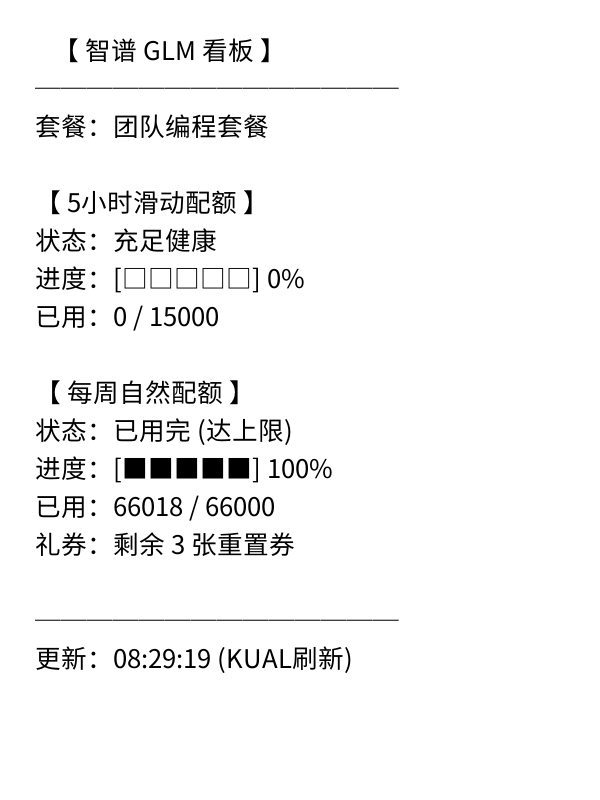

# 📊 智谱 GLM 大模型额度看板 (GLM Usage)

随时随地掌握智谱 AI 的额度消耗——不用回电脑开浏览器。



## 这是什么

在 Kindle 上直接查看智谱 GLM 的 API 用量：5 小时滑动窗口、每周自然周期配额、
重置券余额。**双运行形态**：KOReader 内部浮层，或 KUAL 原生桌面全屏看板。

## 怎么用

- **KOReader 内部**：顶部工具栏 → 更多工具 → **智谱 GLM 用量查询**。
- **KUAL 菜单**：打开 KUAL 书本 → **GLM 用量监控** → **刷新并查看 GLM 用量**。

```text
   【 智谱 GLM 看板 】
──────────────
套餐：团队编程套餐

【 5小时滑动配额 】
状态：充足健康
进度：[□□□□□] 0%
已用：0 / 15000

【 每周自然配额 】
状态：已用完 (达上限)
进度：[■■■■■] 100%
已用：66018 / 66000
礼券：剩余 3 张重置券

──────────────
更新：14:15 (已刷新)
```

## 特点

- **HS256 签名动态认证**：不需要中转服务，Kindle 本地用 `openssl` 或 Python
  动态生成 JWT，直接和智谱开放平台通信。
- **多维度配额全景**：5 小时滑动窗口、每周自然周期、剩余 Token / 额度 / 重置时间。
- **两种呈现**：KOReader 内是文字浮层；KUAL 桌面版用 `fbink` 硬件加速直刷墨水屏全屏，
  字符进度条卡片排版。

## 相关文档

配置与部署见仓库 README 的「配置指南」一节。
