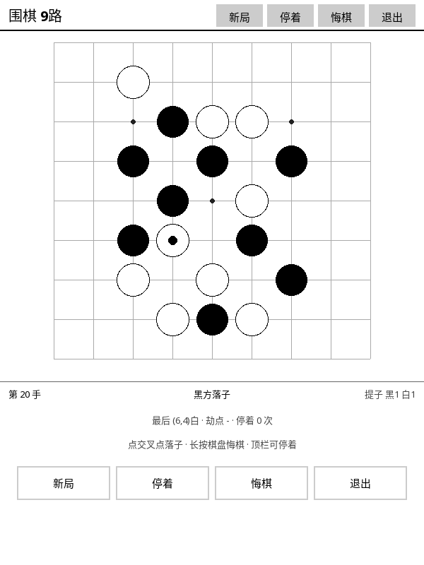

# ⚫ 围棋 (Go)

9 路棋盘，带提子、简单打劫、停着和算分。黑白子靠**实心圆 / 带黑边描的空心圆**区分，不靠灰度深浅猜。

## 这是什么

一盘能下完的 9 路围棋。选 9 路而不是 19 路，是因为 600×800 的墨水屏上 19 路太密，
交叉点挨在一起没法点；9 路则每一步都落得准。

## 怎么玩

1. 打开 KOReader → 顶部工具栏 **工具** → **围棋 (Go)**。
2. **点交叉点**落子（落点判定取离手指最近的交叉点，横向纵向各留半个线距的容差，盲操友好）。
3. **长按棋子 = 悔棋**。
4. 顶栏：**新局 / 停着 / 悔棋 / 退出**；屏幕下方还有一排 **48px 高的大按钮**，同样能点。
5. 信息行实时显示：当前手数、轮到谁走、双方提子数、最后一手位置、劫点、停着次数。
6. 退出后自动存盘。

## 黑白子怎么区分

| | 画法 |
| :--- | :--- |
| 黑子 | 实心黑圆 |
| 白子 | 底下垫一个略大的黑圆、上面盖白圆 → 形成 **2px 黑描边环** |
| 最后一手 | 叠一个异色小圆点（黑子配白点、白子配黑点） |

描边环是**用形状画出来的**，不是"白一点的灰"，所以在 16 级灰度下也不会糊成一团。

## 支持的规则

| 规则 | 说明 |
| :--- | :--- |
| 提子 | 落子后对方相邻无气的整条棋链全部提走 |
| 禁自杀 | 自己那口气没了就是非法，自动回滚 |
| 打劫 | **简单劫**：上一步恰好只提一子、且提子方那块棋只剩一口气时记劫点，对方不能立即下在那里；隔一手或对方停着即解除 |
| 停着 | 双方各可停一手，连续两次停着判终局；盘面下满也自动终局 |
| 算分 | 面积法（盘上活子 + 己方围空），**无贴目**，黑多于白则黑胜，同分为和棋 |
| 悔棋 | 撤销上一手，提子 / 劫点 / 提子数 / 手数 / 停着次数一起回滚 |

## 特点

- **命中判定偏友好**：取最近的交叉点，横向纵向各 28px 容差（半个线距），手指粗也能点准。
- **刷新只刷动过的点**：落一子只刷 1 个交叉点，提子只刷 2 个（落子点 + 被提点），静止时零刷新。
- **状态可存**：棋盘、劫点、提子数、手数、停着次数全部落盘，存档损坏时自动回落到初始局面。

## 相关文档

深度设计（内部文档）：[`docs/design/GAME_PLUGIN_SPEC.md`](../design/GAME_PLUGIN_SPEC.md)
