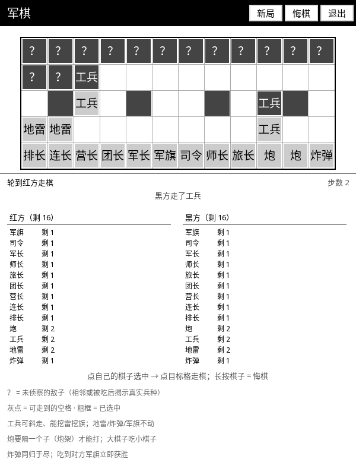

# ⚖️ 军棋 (Junqi)

带**隐藏信息**的陆战棋：对方的棋子先只显示「？」，等你靠近侦察到，才会露出真实兵种。

## 这是什么

两个人面对面用一台 Kindle 下陆战棋（军棋）。棋盘 12 列 × 5 行，双方各 16 枚棋子。
它和象棋最大的不同是**你一开始不知道对面摆了什么**——所以屏幕上先是一排问号。

## 怎么玩

1. 打开 KOReader → 顶部工具栏 **工具** → **军棋 (Junqi)**。
2. **点自己的棋子**选中（格子出现粗黑框），再**点目标格**走棋；
   可走到的空格会先标一个灰点。
3. 再点同一个棋子 = 取消选中；**长按棋子 = 悔棋**。
4. 顶栏三按钮：**新局 / 悔棋 / 退出**。
5. 屏幕下方列出双方各自还剩几枚棋子（红方 / 黑方分开列）。
6. 退出后局面自动存盘。

## 隐藏信息怎么工作

| 情况 | 你看到什么 |
| :--- | :--- |
| 自己的棋子 | 直接显示兵种（红方浅底黑字，黑方深底白字） |
| 对方的棋子，**还没侦察到** | 一个深底的 **「？」** |
| 对方的棋子，**已经侦察到** | 露出真实兵种 |
| 对方棋子**动了** | 你看见了它移动 → 兵种自动暴露 |

**侦察到**有两种途径：

1. **贴近它**：你的棋子走到它旁边，它的兵种就对你公开了。
2. **吃它**：吃掉对方棋子，那枚子是什么自然就知道了。

隐藏信息按**棋子身份**记账，不是按格子——子走了，身份也跟着走；
悔棋时连同"你已经知道的事"一起精确回滚。

## 兵种与规则

| 兵种 | 数量 | 规则 |
| :--- | :--- | :--- |
| 司令 / 军长 / 师长 / 旅长 / 团长 / 营长 / 连长 / 排长 | 各 1 | 8 级军衔，**大棋子吃小棋子** |
| 炮 | 2 | 必须**隔一个子（炮架）**才能打 |
| 工兵 | 2 | 军衔最低，但**能斜走**，而且**能挖雷、挖军旗** |
| 地雷 | 2 | 摆好就不能动，**只有工兵能挖** |
| 炸弹 | 1 | 不能动；**同归于尽** |
| 军旗 | 1 | 不能动；**吃到对方军旗立即获胜** |

棋盘中间一行（第 2、5、8、11 列）是**行营**，用双线方框标出来。

## 特点

- **真·暗战**：开局对面就是一排问号，不是"全亮给你看再假装看不见"。
- **信息是资产**：你每侦察到一枚子，就多一分判断；悔棋会把你侦察到的信息一起退回去。
- **兵种靠字形**：汉字棋子 + 深浅底色，不依赖任何颜色语义。
- **状态可存**：棋盘、双方已知信息、悔棋栈一起落盘。

## 相关文档

深度设计（内部文档）：[`docs/design/GAME_PLUGIN_SPEC.md`](../design/GAME_PLUGIN_SPEC.md)
