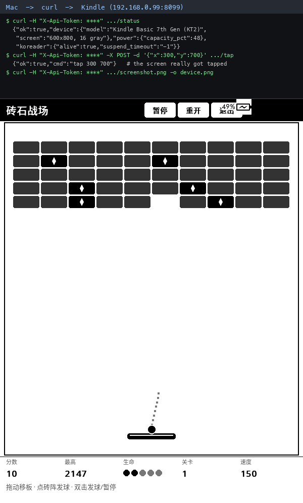

# 📡 Kindle 后台 HTTP 控制接口 (krapi)



让这台 Kindle 变成一个**能被 AI 直接调用的 HTTP 设备**——不用 SSH 敲命令，
一个 HTTP 请求就能点它、长按它、滑动它、截它的屏。

## 这是什么

在 Kindle 上常驻一个 HTTP 服务，提供 `ping` / `status` / `screenshot` / `tap` / `hold` / `swipe`
等接口。AI、脚本、Claude、Codex 都能直接调用。

实现随 skill **`kindle-screen-automation`** 一起提供（`scripts/krapi/`）。

## 接口一览

| 方法 | 路径 | 参数 | 说明 |
| :--- | :--- | :--- | :--- |
| GET | `/ping` | — | 存活探测（不需要令牌） |
| GET | `/status` | — | 电量 / 电流 / 电压 / 内存 / 负载 / IP / KOReader 是否在线 |
| GET | `/screenshot.png` | — | 当前屏幕 PNG（600×800 灰度），**取完立即删设备端文件，零残留** |
| GET·POST | `/tap` | `x` `y` | 点按 |
| GET·POST | `/hold` | `x` `y` `ms` | 长按（默认 1200ms） |
| GET·POST | `/swipe` | `x1` `y1` `x2` `y2` `ms` | 滑动（默认 400ms） |
| GET | `/logs` | `n` | 服务日志尾部 |

坐标范围 `x 0-599`、`y 0-799`，越界返回 400。

## 怎么用

```bash
# 一键部署（装好服务、生成令牌、挂上开机自启）
~/.agents/skills/kindle-screen-automation/scripts/krapi/install.sh 192.168.0.99 8099

# 命令行客户端
~/.agents/skills/kindle-screen-automation/scripts/krapi/krapi.sh status
~/.agents/skills/kindle-screen-automation/scripts/krapi/krapi.sh shot /tmp/s.png
~/.agents/skills/kindle-screen-automation/scripts/krapi/krapi.sh tap 248 80

# 裸 HTTP
TOKEN=$(ssh -p 2222 root@192.168.0.99 cat /mnt/us/krapi/token)
curl -H "X-Api-Token: $TOKEN" http://192.168.0.99:8099/status
curl -H "X-Api-Token: $TOKEN" http://192.168.0.99:8099/screenshot.png -o /tmp/s.png
curl -H "X-Api-Token: $TOKEN" "http://192.168.0.99:8099/tap?x=248&y=80"
```

## 特点

- **不占 KOReader 的 UI 线程**：服务是独立进程，一个慢客户端不会把阅读器卡住；
  KOReader 崩了、重启了、退出到桌面了，服务都还活着。
- **开机自启**：挂在越狱注册的 root 钩子上，`/mnt/us/emergency.sh`。
- **自愈**：内置防火墙看门狗，越狱重建规则后自动补回。
- **零残留**：截图取完立刻删设备端那张。
- **有鉴权**：16 字节随机令牌，写在 `/mnt/us/krapi/token`。

> ⚠️ **安全**：服务监听 `0.0.0.0`，**只应跑在可信局域网里**。
> 令牌是唯一防线，截屏会暴露屏幕内容。
> 刻意**没有**开放任意命令执行接口 —— root shell over HTTP 等于把整台设备交出去。

## 相关文档

深度设计与运维细节（内部文档）：[`docs/design/KINDLE_API.md`](../design/KINDLE_API.md)
