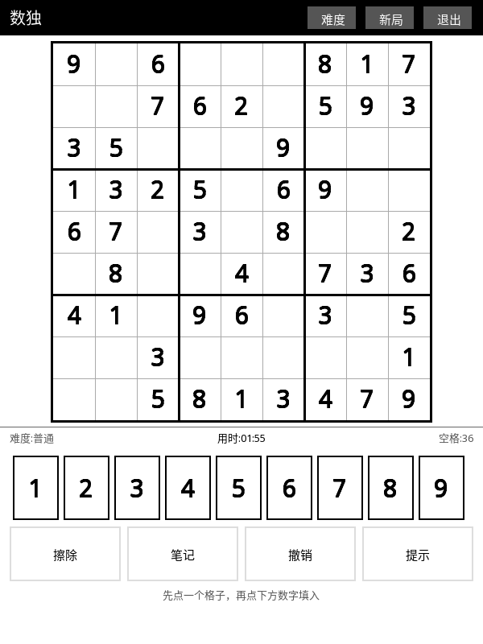
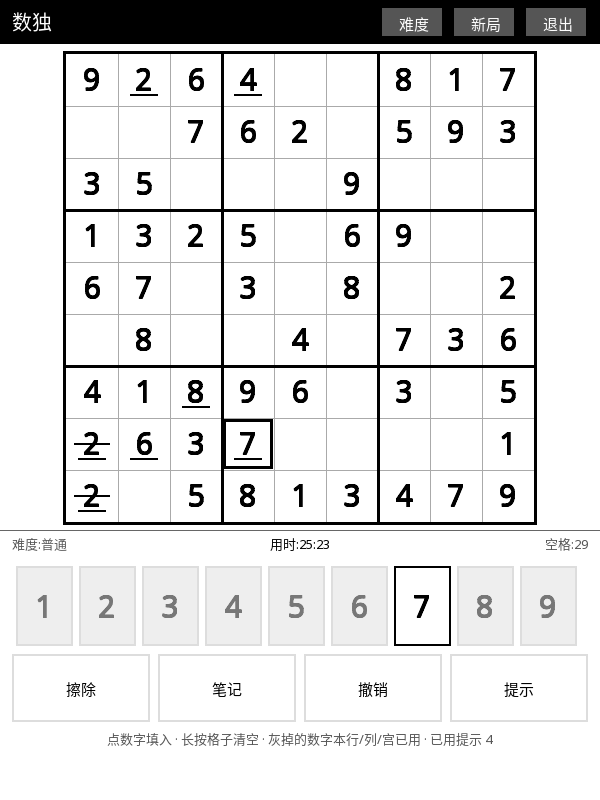
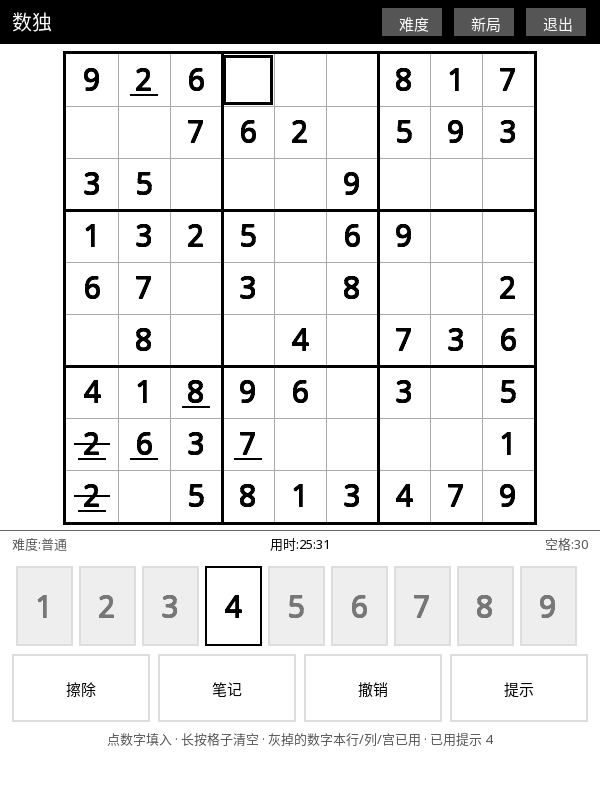

# 🔢 数独 (Sudoku)

纸面游戏搬到墨水屏——本来就是静态画面，静止时零刷新，是墨水屏上最省电的一类游戏。

## 这是什么

完整的数独：唯一解保证的题目、三档难度、笔记候选、撤销、提示、进度存档。
视觉全部**形状化**，不依赖任何颜色语义。

## 怎么玩

1. 打开 KOReader → 顶部工具栏 **工具** → **数独 (Sudoku)**。
2. **点一个空格**选中它（格内出现粗框），再**点下方数字**填入；再点同一个数字 = 擦掉。
3. **长按格子**直接清空该格。
4. **笔记**按钮切到候选模式，此时点数字是"加/取消候选数"（小号浅灰字）。
5. **撤销**回退上一步（填数 / 擦除 / 笔记都算）。
6. **提示**自动填一个正确的数进空格，提示次数显示在底部提示行。
7. 数字键盘会把**本行/列/宫已经用过**的数字变灰 —— 灰的就是这一格不能填的。
8. 顶栏三按钮：**难度 / 新局 / 退出**；退出后进度自动存盘，下次进来接着玩。

## 长按清空前后对比

| 长按前 | 长按后 |
| :---: | :---: |
|  |  |

左图第 1 行第 4 格是玩家填的 `4`（数字下方一条短横线），
长按后该格清空、变成选中格，键盘里的 `4` 也随之恢复可用（不再灰）。

## 特点

- **唯一解保证**：出题走"随机挖空 + 逆序恢复直到全局唯一解"，
  困难局实测 **0.013 秒/局**，点「新局」零等待。
- **三档难度**：简单 / 普通 / 困难（给定数 42 / 32 / 25）。
- **形状化视觉**：题目给定 = 纯黑；**玩家填入 = 纯黑 + 数字下方一条短横线**（一眼分清哪些是自己填的）；
  **冲突 = 横穿数字的删除线**（不是红字）；**笔记得号 = 3×3 小号浅灰**。
- **键盘灰掉"已用数字"**，而不是把整行整列反白 —— 只刷 9 个小按钮，
  比反白整行整列省一个数量级的刷新预算。
- **进度持久化**：断电、退出插件都不丢局；完成局自动记录**各难度最佳用时**。

## 相关文档

深度设计与真机验证记录（内部文档）：[`docs/design/SUDOKU.md`](../design/SUDOKU.md)
