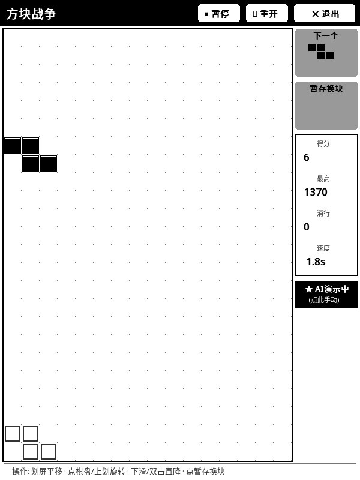

# 🎮 方块战争 (Tetris)

墨水屏上的俄罗斯方块——全屏大视野，物理手感按真机调校过。

## 这是什么

经典俄罗斯方块，但为 **600×800 的 16 级灰度墨水屏**重做：没有颜色、没有动画特效，
所有信息都靠**形状和灰阶**表达，静止时一个像素都不刷新。

## 怎么玩

1. 打开 KOReader → 顶部工具栏 **工具 (扳手与螺丝刀图标)** → **方块战争 (俄罗斯方块)**。
2. **划屏移动**方块，**轻触棋盘空白处**顺时针旋转。
3. **双击屏幕**让方块直接落到底。
4. 右侧「速度」卡片随时轻触微调下落节奏。
5. **按住屏幕不放**方块进入加速下滑（速度卡显示「加速中」），松手立刻恢复常速。
6. **长按右侧「暂存换块」面板**是暂存换块（与加速区互不干扰）。

## 特点

- **全屏大视野**：棋盘占满整屏，不被工具栏挤成一条缝。
- **静止零刷新**：只在方块真的移动时才刷；下落计时器每秒只更新一次时间格。
- **灰阶语义化**：每一行一个明度，落点预览、暂存区、速度卡各有自己的灰阶，
  阳光下的墨水屏上也分得清。
- **加速不误触**：长按加速与长按暂存按区域分流，按错地方不会换块。
- **双击落底**：赶时间时一下到底，不用一点点挪。

## 相关文档

深度设计（内部文档）：[`docs/design/TETRIS_ACCEL.md`](../design/TETRIS_ACCEL.md)
