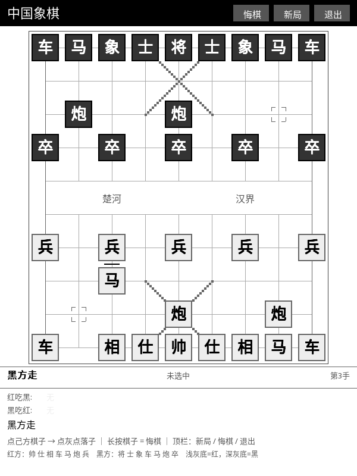

# 🐎 中国象棋 (Xiangqi)

汉字棋子直接摊在屏幕上——墨水屏最占便宜的一个棋类。楚河汉界、九宫斜线、炮架，全套中国象棋规则。

## 这是什么

同机双人对弈的中国象棋，棋子直接用汉字，**红方浅底黑字、黑方深底白字**，
中间一条楚河汉界把棋盘一分为二。规则按中国象棋走，不按国际象棋偷懒。

## 怎么玩

1. 打开 KOReader → 顶部工具栏 **工具** → **中国象棋 (Xiangqi)**。
2. **点自己的棋子**选中，再**点目标格**落子。
3. 再点同一个棋子 = 取消选中；**长按棋子 = 悔棋**。
4. 顶栏三按钮：**悔棋 / 新局 / 退出**。
5. 底部会列出**红方吃了黑什么、黑方吃了红什么**，一目了然。
6. 退出后局面自动存盘。

## 支持的规则

| 规则 | 说明 |
| :--- | :--- |
| 车 | 直线走、不穿子 |
| 马 | 走日字，**蹩马腿**（相邻有子就跳不过去） |
| 象 / 相 | 走田字、塞象眼、**不过河** |
| 士 / 仕 | 只在九宫里走斜格 |
| 帅 / 将 | 只在九宫里走直格；**帅将不可照面**（送将必被拒） |
| 炮 | 直线走；吃子时必须**恰好隔一个炮架** |
| 兵 | 只能前进；**过河后可以横走**；不能后退 |
| 吃子 | 不能吃己方、不能自送将 |
| 判负 | 将死、困毙都判负 |

## 非法走法会告诉你原因

不是简单地"动不了"，而是给出中文原因：

> 蹩马腿有明确原因 · 照面有明确原因 · 炮要炮架 · 象不过河 · 兵不能后退 · 会照面 · 会被将军

## 特点

- **汉字即形状**：不用 Unicode 符号，不依赖字体字形；红黑靠底色深浅区分。
- **河界真的断开**：中间竖线在河界处断开（不是穿过河），这是实打实的中国象棋棋盘。
- **棋子面板带吃子记录**：被吃的子按红/黑分开列在底部。
- **状态可存**：棋盘、行棋权、悔棋栈一起落盘，存档异常时自动丢弃历史而不是崩溃。

## 相关文档

深度设计（内部文档）：[`docs/design/GAME_PLUGIN_SPEC.md`](../design/GAME_PLUGIN_SPEC.md)
